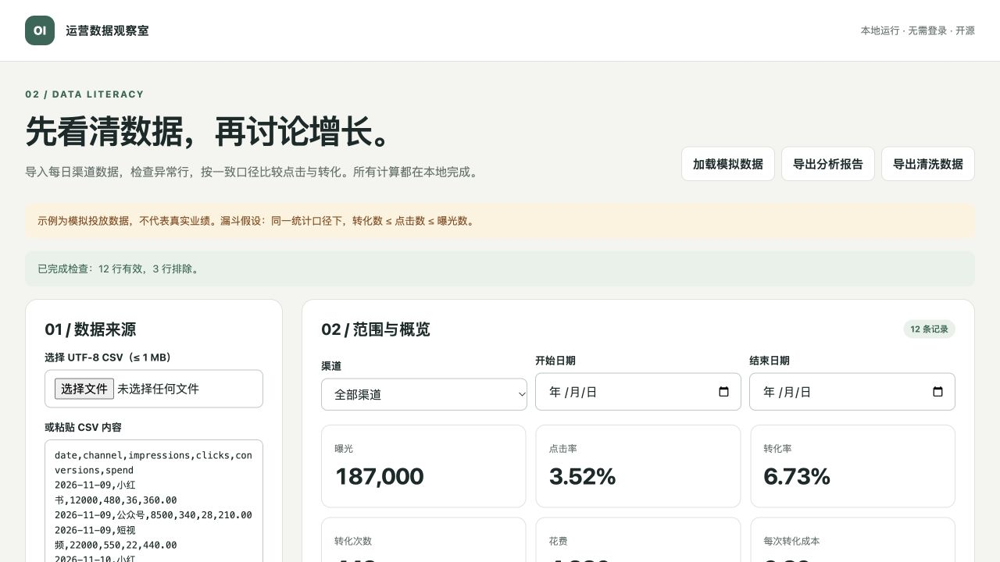

# 运营数据观察室 · ops-csv-insight

先检查 CSV 的质量，再按相同口径观察渠道表现。

**零第三方依赖 · 本地运行 · 中文界面 · MIT**

这是 `hx819-x` 的开源学习作品，初始实现与测试由 Codex 辅助完成。仓库展示可运行的工具和设计取舍，不声称真实商业成果、用户规模或长期维护记录。示例数据和案例均为模拟。

## 产品与运营视角

[产品说明与验收标准](PRODUCT.md)记录了目标用户、需求优先级、设计取舍、待验证指标和下一轮计划。适合结合实际演示说明产品思考。



## 立即运行

下载仓库后直接双击 `index.html`，不需要账号、API key 或安装依赖。文件模式的本地保存行为因浏览器而异；推荐用本地服务获得稳定的同源存储：

```sh
python3 -m http.server 8000 --bind 127.0.0.1
```

然后访问 `http://127.0.0.1:8000`。也可以把仓库根目录作为静态站点部署。页面只读取本地输入，不上传内容；无 CDN、外部字体或统计脚本。

## 功能

- 支持 UTF-8 BOM、CRLF、引号逗号、转义引号和字段内换行。
- 排除非法日期、空字段、负数、非整数计数、漏斗错误与重复日期/渠道主键。
- 筛选日期和渠道；总量加权点击率、转化率、每次转化成本。
- 渠道对比、每日转化条形图、可见的错误记录表。
- 导出分析 Markdown 和当前筛选范围的清洗 CSV；CSV 文本做公式注入防护。

## 三分钟演示

1. 直接打开 `index.html`，默认加载 `sample.csv` 模拟数据。
2. 应看到 15 条原始记录、12 条有效记录、3 条排除记录，总转化 443。
3. 切换渠道与日期，观察汇总与图表同步变化。
4. 导出报告，核对公式。再导入自己的去标识化 CSV。

## 可以解释的设计决策

- 为什么不能直接平均两条内容的点击率？可用 100 曝光 / 50 点击与 900 曝光 / 90 点击说明整体为 14%。
- 零转化时的转化成本为什么显示“—”，而不是 0？
- 为什么排除重复主键，并保留可检查的错误原因？
- 渠道表现不同能否证明因果？还缺哪些归因、样本量与周期信息？

## 限制与口径

数据模型假定每行是一个日期和一个渠道，转化 ≤ 点击 ≤ 曝光。它不适用于不同归因窗口、重复转化等不满足这一假设的报表。只接受固定六列，可调整顺序：date, channel, impressions, clicks, conversions, spend。计数必须为非负整数，花费最多两位小数；单值不超过 10^12；最多 10,000 行。币种由使用者统一，本工具不推断币种或因果。重复主键保留第一条有效记录。CSV 中“记录序号”不等于含多行字段时的物理文本行号。读取失败会保留上一次成功分析的结果并显示错误。不会保存原始 CSV 到 localStorage。

输入内容以 `textContent` / 表单值呈现，不作为 HTML 执行。导入文件限制 1 MB。请不要把真实个人信息、公司数据、账号凭据提交到仓库；本地导出的文件由使用者自行管理。

## 开发与测试

需要 Node.js 20 或更新版本；无需 `npm install`：

```sh
npm test
```

当前包含 **10 项核心逻辑测试**。`core.js` 同时供浏览器和 Node 使用；`app.js` 管理 DOM、文件导出与交互；`style.css` 提供响应式布局；`test.cjs` 验证边界条件与数据口径。

| 文件         | 作用                 |
| ------------ | -------------------- |
| `index.html` | 可访问的中文页面结构 |
| `core.js`    | 纯逻辑与输入校验     |
| `app.js`     | 界面与导入导出       |
| `test.cjs`   | 自动化测试           |
| `sample.csv` | 可复现的模拟输入     |
| `LICENSE`    | MIT 开源许可         |

## 后续改进与贡献

欢迎通过 Issue 提供复现步骤、脱敏示例、预期与实际结果。提交修改前运行测试。建议先增加新的真实使用反馈，再选择功能；不为凑功能数量引入账号、外部 API 或数据收集。

作品集介绍建议写“使用 AI 辅助完成工具原型，并理解、验证其关键逻辑”；能亲自演示和解释后，再具体描述自己完成的修改与贡献。
